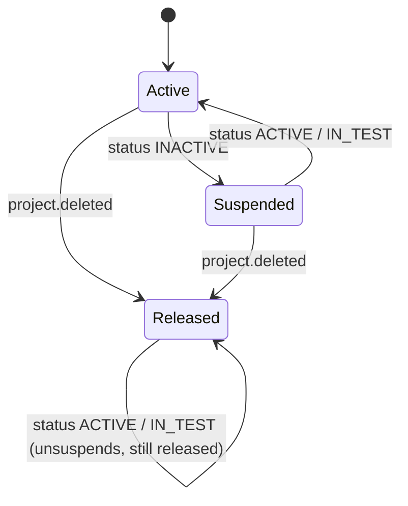

# Data Model: Consume project events from AmazonMQ

**Feature**: [spec.md](./spec.md) | **Plan**: [plan.md](./plan.md) | **Research**: [research.md](./research.md)

No table or column changes, so there is no migration. The entities below are in-process message shapes plus the `Org` fields the events write.

## AmazonMQ event envelope

The `weni-eda` `Event`, parsed with `Message.event()` (which is `Event(**json)`). A missing or extra top-level key raises `TypeError`, and the message is rejected. `Event` checks no types, so `ProjectEventEnvelope.from_event(event)` (in `project_event_payloads.py`) validates the fields that are logged, for every event type, before anything is logged. `TOKEN` below means a `str` that fully matches `ENVELOPE_TOKEN_PATTERN` (`[A-Za-z0-9._:-]{1,64}`).

| Field | Accepted | Use |
|-------|----------|-----|
| `event_id` | `TOKEN` | Correlation identifier in logs, the Sentry tag, and the rejection message. |
| `event_type` | `TOKEN` | Routing key. Selects the handler. |
| `producer` | `TOKEN` or `null` | Logged only. |
| `timestamp` | anything | Not used, not validated. |
| `data` | object | Validated per event type (below). |

## Validated payloads

These are the frozen dataclasses in `temba/projects/consumers/project_event_payloads.py`. Each `from_data(data)` raises `InvalidProjectEvent` naming the field and rule, never the value. The validation rules are in [research.md R1](./research.md#r1-payload-validation-explicit-validators-not-drf-serializers).

| Dataclass | Built from `event_type` | Fields (type after validation) |
|-----------|-------------------------|--------------------------------|
| `ProjectUpdatedData` | `project.updated` | `project_uuid: str` (canonical UUID), `user_email: str`, `name: str \| None`, `description: str \| None`, `language: str \| None`, `timezone: str \| None` |
| `ProjectStatusUpdatedData` | `project.status.updated` | `project_uuid: str`, `user_email: str`, `status: ProjectStatus` |
| `ProjectTypeUpdatedData` | `project.type.updated` | `project_uuid: str`, `user_email: str`, `is_multi_agents: bool` |
| `ProjectDeletedData` | `project.deleted` | `project_uuid: str`, `user_email: str` |

`data.uuid` maps to `project_uuid`, which is `Org.proj_uuid`.

## Legacy project message (unchanged shape)

A flat JSON body on `flows.project-events`, validated by the existing `ProjectEventConsumer._validate_message`: `project_uuid`, `action` (`EventAction`) and `user_email` are required, and `status` is required for `status_updated`. `is_multi_agents` is still coerced with `bool()`. The only behaviour change is the skip in [the decision table](#decision-tables). `project_uuid` is not validated as a UUID, so the context stores `canonical_uuid(project_uuid)`, which is `None` for a value that is not a UUID.

## `ProjectEventContext`

A mutable dataclass in `temba/projects/consumers/project_events.py`, filled as processing advances. It holds only opaque identifiers, so it is safe as a frame local and in the rejection message.

| Field | Set when | Used by |
|-------|----------|---------|
| `event_id: str \| None` | Envelope validated (AmazonMQ only) | Logs, Sentry tag, rejection message |
| `event_type: str \| None` | Envelope validated (AmazonMQ only) | Logs, Sentry tag, rejection message |
| `action: str \| None` | Legacy body validated | Logs, Sentry tag, rejection message |
| `project_uuid: str \| None` | AmazonMQ: payload validated. Legacy: body validated, then `canonical_uuid`. | Logs, Sentry tag, rejection message |
| `org_id: int \| None` | AmazonMQ: org lookup. Legacy: looked up in the `except` block. | Sentry tag, logs |
| `user_id: int \| None` | Right before the use case: `find_user_id(user_email)`, read-only. `None` when no `User` has the e-mail. | Sentry tag |

## `ProjectEventRejected`

`Exception` subclass raised `from None` by both `consume` methods after `report_exception`. Its message is `project event rejected: event_id=<…> event_type=<…> project_uuid=<…> reason=<…>`. For legacy messages, `action=<…>` replaces `event_type` and there is no `event_id`. `reason` is the `InvalidProjectEvent` text, or else the class name of the original exception.

## Legacy action list

`settings.PROJECT_EVENTS_LEGACY_ACTIONS: list[str]`.

| Source | Value |
|--------|-------|
| Variable unset | `["updated", "status_updated", "project_type_update", "deleted"]` |
| Variable `""` | `[]` |
| Variable `"project_type_update"` | `["project_type_update"]` |
| Any item outside `EventAction` | System check `projects.E001` fails and the process does not start |

Mapping from AmazonMQ event type to legacy action: `LEGACY_ACTION_BY_EVENT_TYPE` in `project_consumer.py`.

| `event_type` | Legacy action | Use case |
|--------------|---------------|----------|
| `project.updated` | `updated` | `update_project_config` |
| `project.status.updated` | `status_updated` | `update_project_status` |
| `project.type.updated` | `project_type_update` | `update_project_type` |
| `project.deleted` | `deleted` | `delete_project` |

## Org fields written

`temba.orgs.models.Org`. The use cases are unchanged except for the deletion guard and the log lines.

| Event | Fields written | Writes when |
|-------|----------------|-------------|
| `project.updated` | `name`, `language` (only when the value differs); `config["description"]`, `timezone` (when not `null`); `modified_by`, `modified_on` (always) | Every valid event for an existing org |
| `project.status.updated` | `is_suspended`, `modified_by`, `modified_on` | `is_suspended` changes |
| `project.type.updated` | `config["is_multi_agents"]`, `modified_by`, `modified_on` | The flag changes |
| `project.deleted` | `is_active=False`, `released_on`, `modified_by`, `modified_on`; channels released; org users removed. All in one transaction. | Org `is_active` (new guard) |

## Org state transitions

`is_active` is reserved for release. `is_suspended` is driven by the status.

## Decision tables

### `ProjectConsumer` on `flows.projects.queue`

Rows are evaluated top to bottom. The first row that matches decides the outcome.

| Condition | Outcome | Log |
|-----------|---------|-----|
| Body is not JSON, or the envelope does not match `Event` | Reject, report to Sentry | `weni-eda` rejection error |
| `event_id`, `event_type` or `producer` not accepted (any event type) | Reject, report to Sentry | `weni-eda` rejection error, without the rejected values |
| `event_type == project.created` | Current creation path, then ack | `project_event_consumed` |
| `event_type` not one of the four new types or `project.created` | Ack, no effect | `project_event_consumed` |
| Payload invalid (R1) | Reject, report to Sentry | `weni-eda` rejection error |
| Legacy action is in `PROJECT_EVENTS_LEGACY_ACTIONS` | Ack, no use case | `project_event_consumed`, `project_event_skipped reason=legacy_consumer_applies` |
| No org with `proj_uuid == data.uuid` | Ack, no use case | `project_event_consumed`, `project_event_org_not_found` (warning) |
| Use case raises (`user_id` looked up just before it) | Reject, report to Sentry | `weni-eda` rejection error |
| Otherwise | Use case applied, ack | `project_event_consumed` |

### `ProjectEventConsumer` on `flows.project-events`

| Condition | Outcome | Log |
|-----------|---------|-----|
| Body invalid (existing `_validate_message`) | Reject, report to Sentry | `weni-eda` rejection error |
| `action` not in `PROJECT_EVENTS_LEGACY_ACTIONS` | Ack, no use case | `project_event_consumed`, `project_event_skipped reason=amazonmq_consumer_applies` |
| Otherwise | Current behaviour: use case applied, then ack. Missing org on `updated` still rejects. | `project_event_consumed` |
