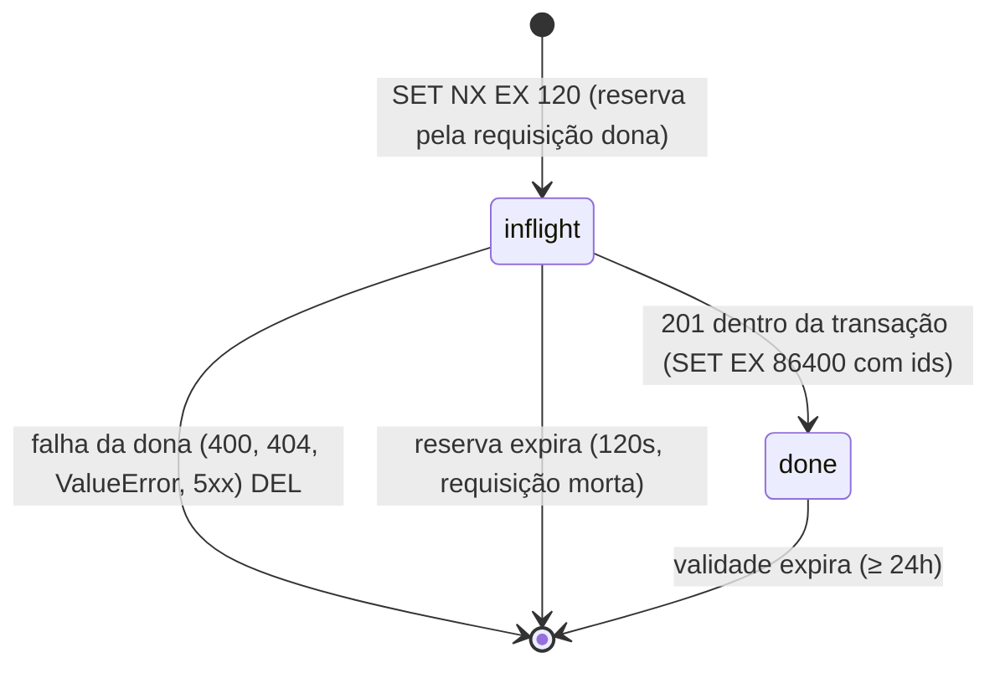

# Data Model: componentes de streaming do Shopping Assistant em `POST /api/v2/internals/messages/stream`

**Feature**: `022-sa-components-streaming` | **Date**: 2026-11-24 | **Plan**: [plan.md](plan.md)

Sem migration. Nenhuma tabela ou coluna nova. O formato dos campos vem do contrato no pin `329a1db` ([contracts/README.md](contracts/README.md)).

## 1. Registro de mensagem — `Msg` (`msgs_msg`, inalterado)

| Campo | Origem | Regra |
|---|---|---|
| `text` | primeiro preenchido entre `text`, `message` e `msg.text`, ou `""` | Inalterado (FR-017). Pode ser `""` quando há componente (FR-012). |
| `metadata` | `msg` do corpo | O **dicionário original** de `msg`, depois de validado. Sem renomear, converter, calcular ou remover campos (FR-014). Chaves de `msg` fora dos seis campos são preservadas (FR-010). |
| demais | inalterados | Contato, URN, canal, direção, status, datas, `attachments`, `template` e labels seguem `create_message_db_only` como hoje (FR-015, FR-016). |

Cardinalidade: uma linha por URN, como hoje. Com `Idempotency-Key` válida, as linhas da requisição são criadas na mesma transação (research R8).

## 2. `msg` — `StreamMsgPayload` (validação só dos seis campos)

`msg` precisa ser um objeto JSON, como no `DictField` de hoje. As chaves fora da tabela abaixo ficam abertas e não são validadas. Cada campo da tabela é opcional; quando presente, `null` é rejeitado.

| Campo | Tipo | Regras | Objeto fechado? | FR |
|---|---|---|---|---|
| `quick_replies` | lista | ≥ 1 item; cada item é texto (`str`) com ≥ 1 caractere, sem trim | não (não é objeto) | FR-002 |
| `list_message` | objeto | `button_text` (obrigatório, texto ≥ 1), `list_items` (obrigatório, lista ≥ 1), `item_count` (opcional) | **sim** | FR-003, FR-004, FR-010 |
| `list_message.list_items[]` | objeto | `uuid` (obrigatório, texto ≥ 1; não exige formato UUID), `title` (obrigatório, texto ≥ 1), `description` (opcional, texto) | **sim** | FR-003, FR-010 |
| `list_message.item_count` | inteiro | ≥ 1; rejeita `bool` e `str`; aceita `int` e `float` com parte fracionária zero | — | FR-004, FR-008 |
| `cta_message` | objeto | `display_text` (obrigatório, texto ≥ 1), `url` (obrigatório) | **sim** | FR-005, FR-010 |
| `cta_message.url` | texto | casa com `^https?://.+` (sensível a maiúsculas) e é URI da RFC 3986 (só ASCII; `%` seguido de dois hex) | — | FR-005 |
| `interaction_type` | texto | `"list"` ou `"cta_url"`; sem regra cruzada com os componentes | — | FR-006 |
| `header` | objeto | `type` (opcional, exatamente `"text"`), `text` (opcional, texto, pode ser `""`) | **sim** | FR-007, FR-010 |
| `footer` | texto | só tipo texto, pode ser `""` | não | FR-007 |

Regras transversais:

- **Tipos estritos (FR-008)**: um número não vale como texto, um texto não vale como inteiro e um `bool` não vale como inteiro nem como texto.
- **Objeto fechado (FR-010)**: uma chave não declarada gera `{"<chave>": ["Unexpected field."]}` no caminho do objeto.
- **Rejeição total (FR-009)**: qualquer erro em `msg` gera `400` com o erro sob `msg`, e nenhuma linha é criada para nenhuma URN.
- **Sem limites novos (FR-011)**: nenhum máximo de itens, de comprimento de texto ou de URL, nem de tamanho de corpo.
- **Conteúdo mínimo (FR-016)**: a regra atual não muda. `msg` não vazio, `text`, `message` ou `attachments` continua bastando.

### Formato de erro (exemplos)

```json
{"msg": {"quick_replies": ["This list may not be empty."]}}
{"msg": {"list_message": {"item_count": ["A valid integer is required."]}}}
{"msg": {"list_message": {"list_items": {"1": {"foo": ["Unexpected field."]}}}}}
{"msg": {"cta_message": {"url": ["Enter a valid http(s) URL."]}}}
{"msg": {"header": {"foo": ["Unexpected field."]}}}
```

Os textos das mensagens são os padrões do DRF ou os do contrato. Só o caminho é verificado pelos testes (FR-009).

## 3. Registro de idempotência (Redis compartilhado)

| Item | Valor |
|---|---|
| Chave Redis | `idempotency:messages_stream:{project_uuid}:{idempotency_key}` (`REDIS_KEY_PREFIX`) |
| `project_uuid` | o do corpo, normalizado por `uuid.UUID`; a permissão já garantiu que ele é o projeto autorizado |
| `idempotency_key` | header `Idempotency-Key` após `strip()`; vale se tiver de 1 a 128 caracteres (`MAX_KEY_LENGTH`) |
| Impressão do corpo | `compute_body_hash(request)`, importado de `broadcasts/idempotency.py`: SHA-256 do JSON com `sort_keys=True` |
| Cliente | `redis.Redis.from_url(CACHES["default"]["LOCATION"])` com `socket_timeout` e `socket_connect_timeout` = `REDIS_TIMEOUT_SECONDS` (2s) |

### Estados e transições



| Estado | Valor JSON | TTL | Quem escreve |
|---|---|---|---|
| `inflight` | `{"state": "inflight", "body_hash": "<sha256>"}` | `INFLIGHT_TTL_SECONDS = 120` | só a requisição que conseguiu o `SET NX` |
| `done` | `{"state": "done", "body_hash": "<sha256>", "ids": [<int>, ...]}` | `DONE_TTL_SECONDS = 86400` | só a requisição dona, ao concluir com `201` |

### Resultado da consulta para uma requisição com chave válida

| Situação no Redis | Resposta | Escreve no Redis? |
|---|---|---|
| chave ausente (o `SET NX` venceu) | segue para validação e criação | sim (reserva) |
| `done` e mesma impressão | `200 {"ids": [...]}` | não |
| `done` e outra impressão | `409 {"code": "idempotency_conflict", "error": "Idempotency-Key reused with different body"}` | **não** |
| `inflight` (qualquer impressão) | `409 {"code": "idempotency_in_progress", "error": "Request with this Idempotency-Key is already being processed"}` | **não** |
| a chave expirou entre o `SET NX` e o `GET` | nova tentativa de `SET NX`; se ainda falhar, trata como `inflight` | conforme o resultado |
| valor ilegível | trata como `inflight` | não |
| `RedisError` ou timeout | `503 {"error": "Service temporarily unavailable"}`, sem linhas | não |

O `409` devolvido a uma requisição duplicada nunca libera nem sobrescreve o registro (FR-024).

## 4. Projeto autorizado (permissão `ModuleJWTProjectScope`)

| Claims do token (`jwt_tenant_claims`) | Projeto autorizado | Nega (`403`) quando |
|---|---|---|
| projeto e canal | o projeto | o canal não pertence ao projeto |
| só projeto | o projeto | — |
| só canal | `org.proj_uuid` do canal ativo | o canal não existe |
| nenhum | — | o autenticador já falhou antes (`403`) |

Comparação com o corpo:

- `project_uuid` presente, normalizado e diferente do autorizado: nega.
- `project_uuid` não é um UUID válido: nega.
- `project_uuid` ausente, ou corpo que não é objeto: não decide aqui, e o serializer devolve `400`.

## 5. Volume por requisição (Peak Load)

- **Validação**: em memória, sem I/O, proporcional ao tamanho de `msg`.
- **Sem `Idempotency-Key`**: zero operações Redis (FR-018).
- **Com `Idempotency-Key`**, no máximo:
  - `SET NX` + `GET` na consulta;
  - `SET` na conclusão, **ou** `DEL` na falha.
- **Chaves vivas**: ≈ requisições com chave nas últimas 24h. Cada valor tem menos de 200 bytes mais 12 bytes por id.
